# Heart Disease Prediction

Predicting the likelihood of heart disease based on clinical metrics using machine learning classification models, robust preprocessing pipelines, hyperparameter tuning, and clinical diagnostic evaluation metrics.

- **Dataset Source**: [Kaggle - Heart Disease Rate](https://www.kaggle.com/datasets/dkwarkaggle/heart-disease-rate) (303 patient records, 13 clinical predictors).
- **Reference**: [Daniel Bourke's End-to-End Heart Disease Classification](https://dev.mrdbourke.com/zero-to-mastery-ml/end-to-end-heart-disease-classification/)

---

## Performance Summary

### 1. Multi-Metric Baseline Comparison (With Preprocessing Pipeline)
| Model | Test Accuracy | Precision | Recall (Sensitivity) | F1-Score | ROC-AUC |
|---|:---:|:---:|:---:|:---:|:---:|
| **Support Vector Classifier (SVC)** | **82.0%** | **77.5%** | **93.9%** | **84.9%** | **0.910** |
| **Logistic Regression** | **80.3%** | **78.4%** | **87.9%** | **82.9%** | **0.881** |
| **K-Nearest Neighbors (KNN)** | **78.7%** | **76.3%** | **87.9%** | **81.7%** | **0.906** |
| **Random Forest** | **77.0%** | **74.4%** | **87.9%** | **80.6%** | **0.891** |

*Note: Feature standardization solved the KNN scale-distortion issue (boosting accuracy from 68% to ~79-80%) and eliminated convergence warnings in linear models.*

### 2. Tuned Model (GridSearchCV Logistic Regression) - 5-Fold Cross-Validation
| Metric | 5-Fold CV Score | Standard Deviation |
|---|:---:|:---:|
| **Accuracy** | **81.8%** | ± 4.7% |
| **Precision** | **81.6%** | ± 5.1% |
| **Recall (Sensitivity)** | **86.7%** | ± 7.6% |
| **F1-Score** | **83.8%** | ± 4.4% |
| **ROC-AUC** | **0.908** | ± 0.033 |

*In medical diagnostics, **Recall** is prioritized: only 4 false negatives out of 33 diseased test patients.*

---

## Key Pipeline Steps

1. **Automated Kaggle Pulling**: Directly fetches latest dataset release from Kaggle using `kagglehub` with automatic fallback to local files.
2. **Exploratory Data Analysis (EDA)**: Analyzed feature distributions, cross-tabulations, and correlation heatmaps across the 13 clinical variables.
3. **Data Preprocessing & Leakage Prevention**:
   - `StandardScaler` on continuous metrics (`age`, `trestbps`, `chol`, `thalach`, `oldpeak`).
   - `OneHotEncoder` on discrete categorical features (`cp`, `restecg`, `slope`, `thal`).
   - Encapsulated within a Scikit-Learn `Pipeline` to prevent train-test data leakage.
4. **Stratified Splitting**: 80/20 train-test split stratified on `target` to preserve exact class balance.
5. **Hyperparameter Tuning**:
   - Manual sweep on KNN (k = 1 to 20).
   - `RandomizedSearchCV` on Logistic Regression and Random Forest.
   - Exhaustive `GridSearchCV` on Logistic Regression.
6. **Clinical Evaluation**: Beyond accuracy: ROC-AUC curves, Confusion Matrix heatmaps, Classification Reports, and 5-Fold Cross-Validation.
7. **Feature Importance Analysis**: Extracted model coefficients (`coef_`) to interpret protective vs. high-risk clinical factors.
8. **Model Serialization**: Exported production-ready pipeline to `heart_disease_model.joblib`.

---

## Visualizations & Interpretations

### Exploratory Data Analysis (EDA)

<p align="center">
  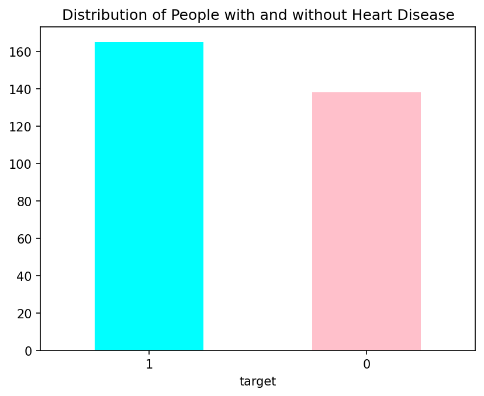
  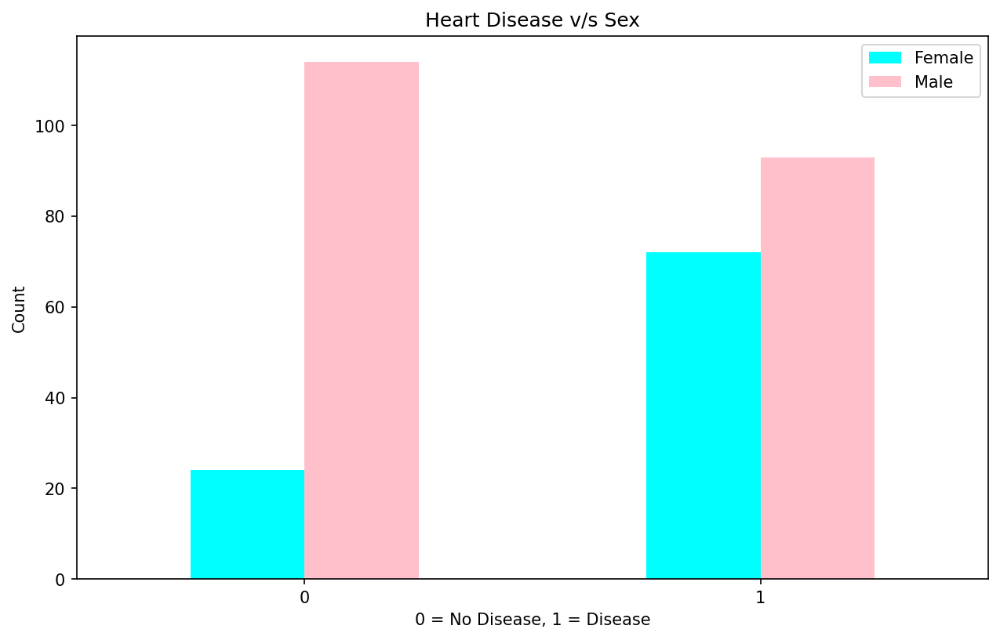
</p>

- **Target Distribution**: Shows 165 positive vs. 138 negative cases (~54.5% vs 45.5%), demonstrating balanced binary target classes.
- **Heart Disease vs. Sex**: Highlights disease prevalence separated by gender across the sample cohort.

<p align="center">
  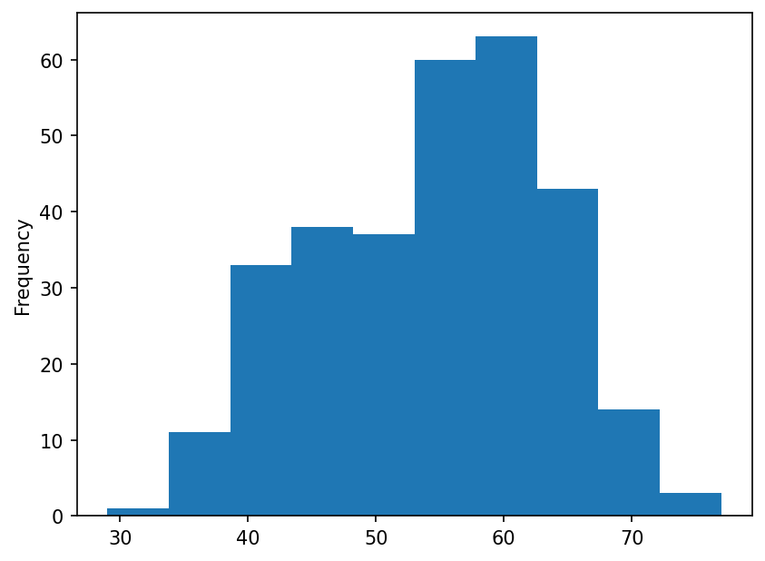
  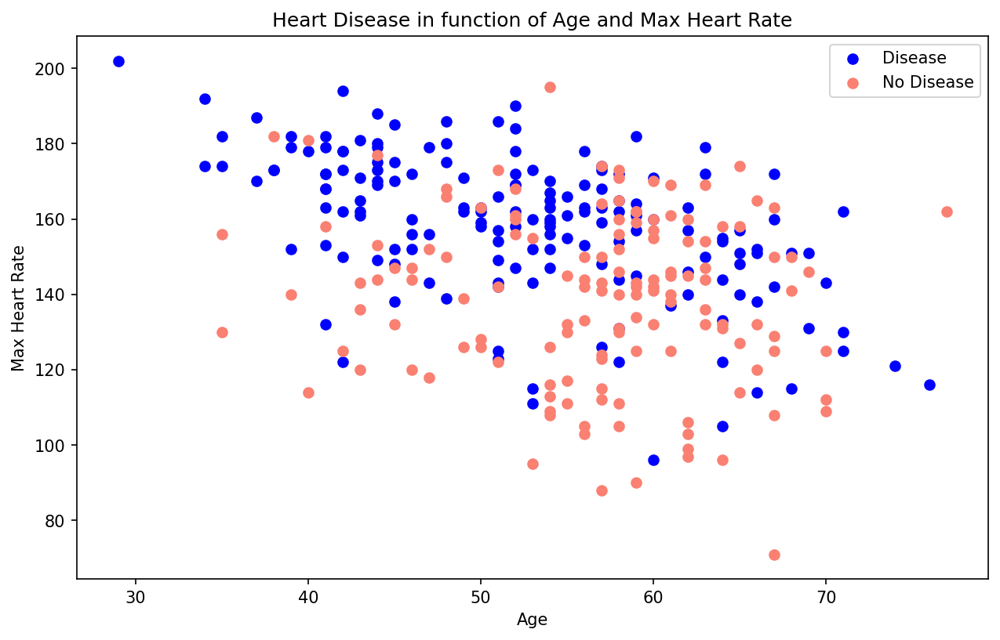
</p>

- **Age Distribution**: Histogram outlining patient demographic (predominantly between ages 45 and 65).
- **Age vs. Max Heart Rate (`thalach`)**: Scatter plot colored by target; shows clear clustering where patients with higher max heart rate have greater frequency of disease.

<p align="center">
  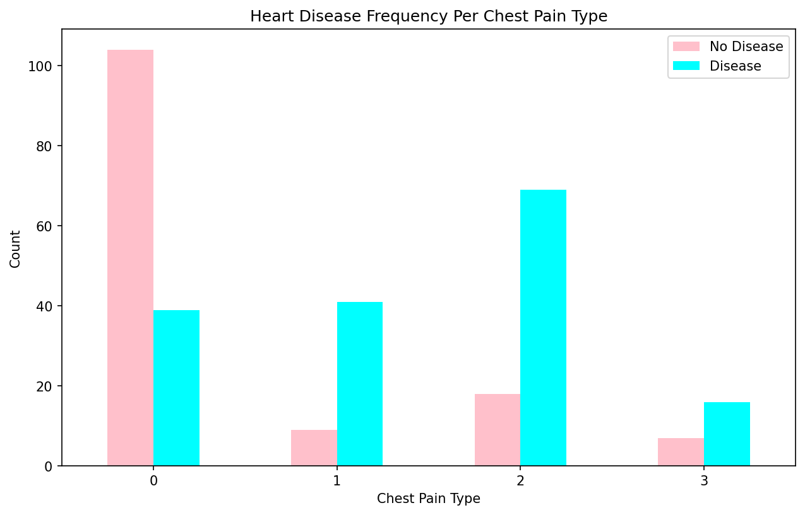
  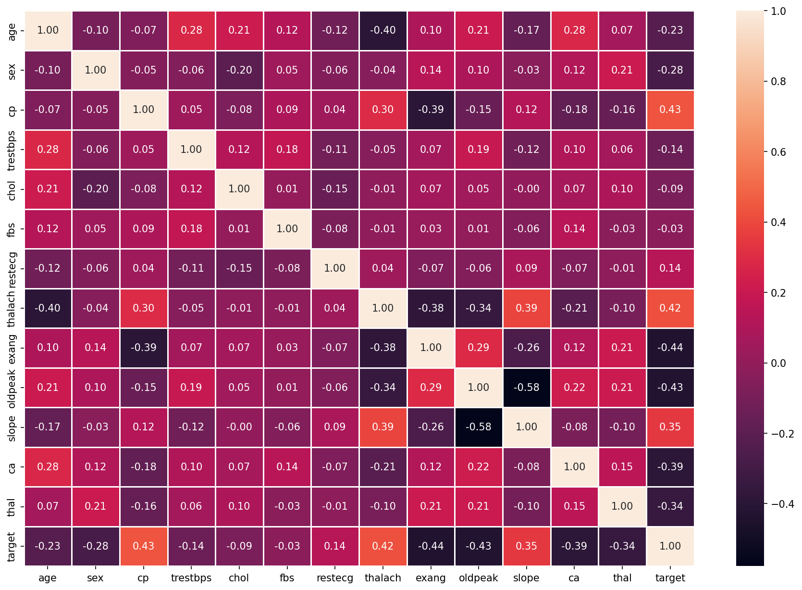
</p>

- **Chest Pain Type (`cp`)**: Demonstrates higher disease incidence in non-anginal and atypical angina categories.
- **Correlation Heatmap**: Visualizes pairwise correlations between all 13 predictors and the diagnosis target.

---

### Model Evaluation & Diagnostic Insights

<p align="center">
  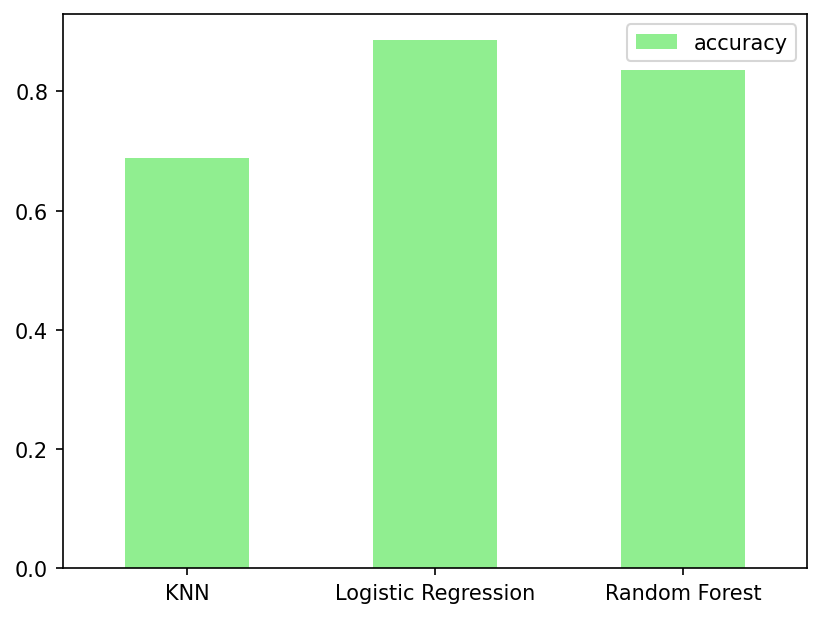
  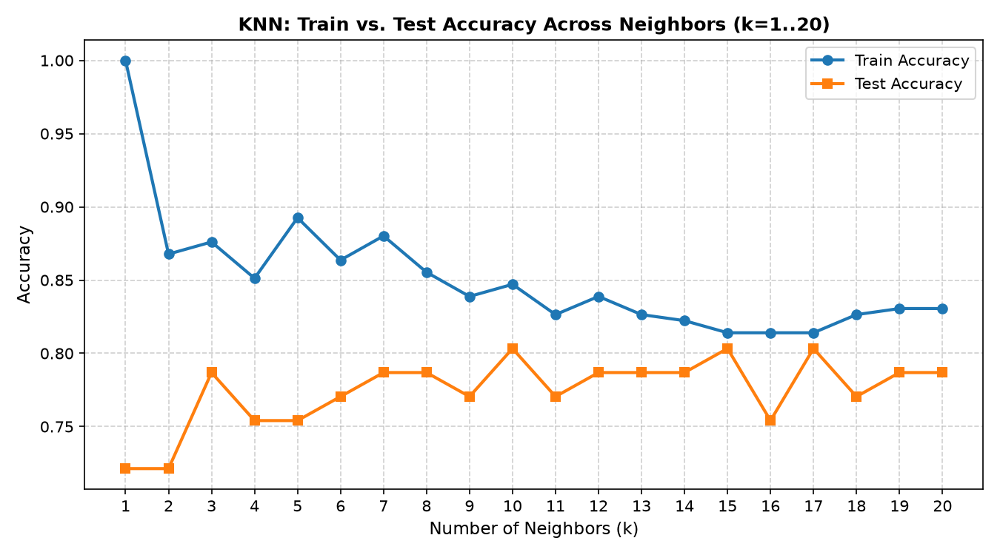
</p>

- **Baseline Accuracy Comparison (`result_model_wise_accuracy_score.png`)**: Initial single-split comparison of raw models, highlighting Logistic Regression leading (~88.5%) and unscaled KNN trailing behind (~68.8%).
- **KNN Tuning (k = 1 to 20) (`knn_hyperparameter_tuning.png`)**: Evaluates training vs. test accuracy across neighbor counts, finding the optimal parameter at k = 10 (80.33%).

<p align="center">
  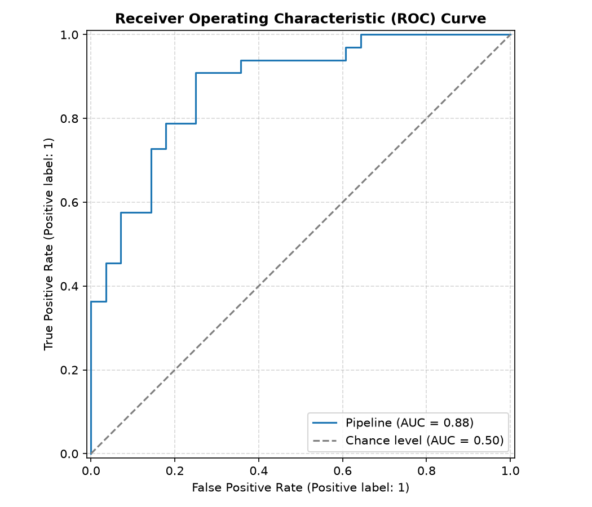
  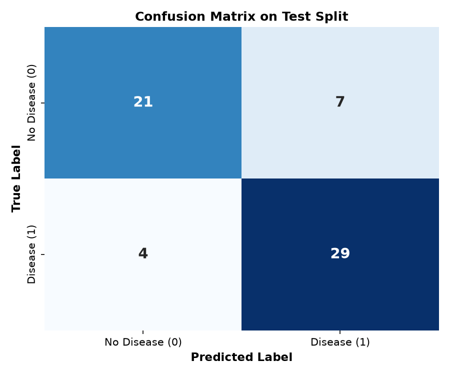
</p>

- **ROC-AUC Curve (`roc_auc_curve.png`)**: Demonstrates strong trade-off between True Positive Rate and False Positive Rate against chance level (AUC ≈ 0.89 - 0.90).
- **Confusion Matrix (`confusion_matrix.png`)**: On 61 test patients, model achieves 21 True Negatives and 29 True Positives, with only 4 False Negatives (88% Recall).

<p align="center">
  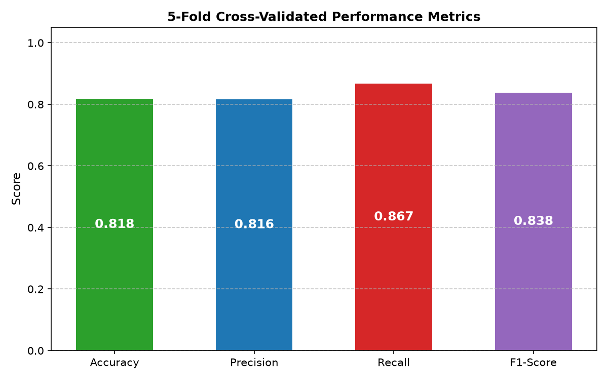
  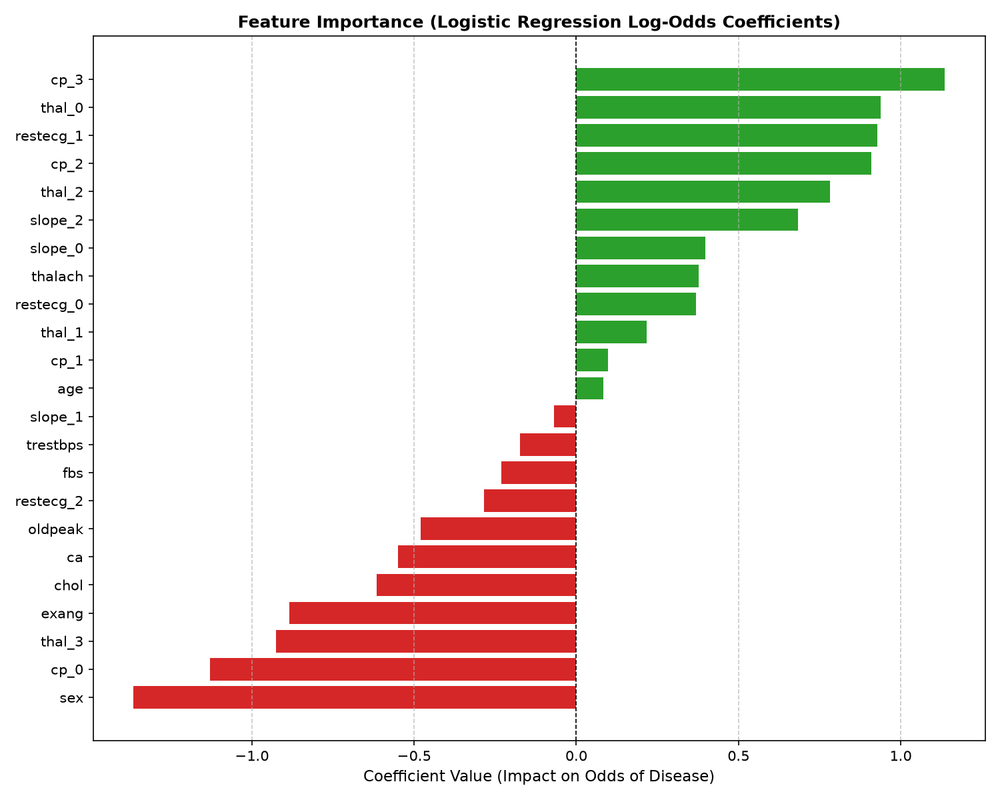
</p>

- **5-Fold Cross-Validation (`cross_validated_metrics.png`)**: Validates that balanced performance persists across random data folds without single-split bias (Recall: 86.7%, Precision: 81.6%).
- **Feature Importance (`feature_importance.png`)**: Positive log-odds coefficients (green: `cp_3`, `thalach`, `slope_2`) increase disease likelihood, while negative log-odds coefficients (red: `sex`, `cp_0`, `ca`, `exang`) correlate with lower risk.

---

## Quickstart & Reproduction

### 1. Clone & Set Up Environment
```bash
git clone https://github.com/dkwargit/heart_disease_prediction_ml.git
cd heart_disease_prediction_ml

# Create and activate virtual environment
python3 -m venv .venv
source .venv/bin/activate

# Install dependencies
pip install -r requirements.txt
```

### 2. Run the Notebook
Open `heart_disease_pred.ipynb` in VS Code or JupyterLab:
```bash
jupyter notebook heart_disease_pred.ipynb
```
Select the **Python (heart-disease-ml)** kernel.

### 3. Make Live Patient Predictions
Run the standalone inference script:
```bash
python predict.py
```
Output:
```text
============================================================
Heart Disease Clinical Prediction System
============================================================

--- Testing Sample Patient 1 (Elevated Risk Profile) ---
Diagnosis:   Heart Disease Detected (High Risk)
Probability: 75.9% disease risk

--- Testing Sample Patient 2 (Lower Risk Profile) ---
Diagnosis:   No Heart Disease Detected (Low Risk)
Probability: 39.4% disease risk
============================================================
```

---

## Tech Stack
`Python` · `scikit-learn` · `pandas` · `numpy` · `matplotlib` · `seaborn` · `kagglehub` · `joblib`
